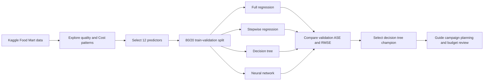
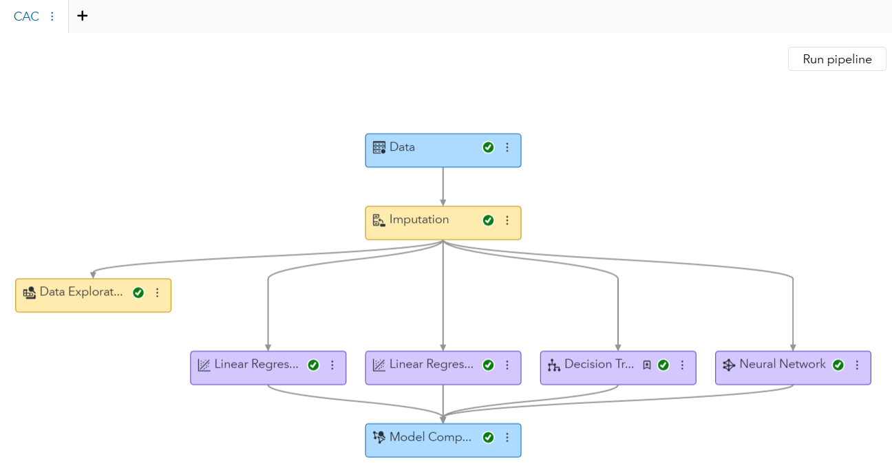
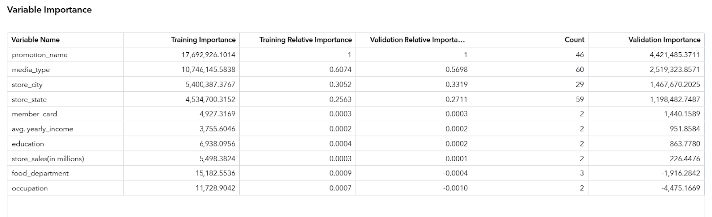
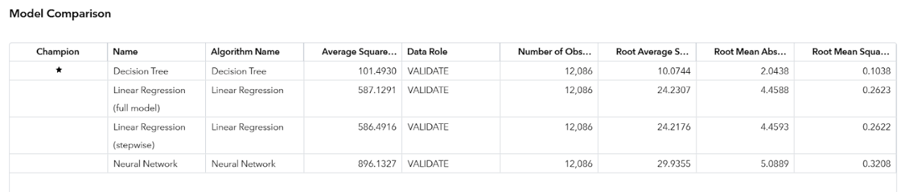

# Food Mart Marketing Campaign Cost Prediction

A SAS Viya modeling project using Food Mart data to understand and predict the dataset's `Cost` measure, and identify promotion, media, and location patterns associated with it.

## Business question

How can Food Mart estimate customer acquisition costs and identify cost-efficient combinations of promotions, media types, and store locations?

## My role

I led the analysis in SAS Viya: explored and prepared the data, selected predictors, compared models, interpreted results, and developed business recommendations.

## Data and preparation

- **Source:** [Kaggle — Cost Prediction on Acquiring Customers](https://www.kaggle.com/datasets/ramjasmaurya/medias-cost-prediction-in-foodmart)
- **Dataset described in the project:** 60,428 rows and 40 columns.
- **Target:** `Cost`.
- **Preparation:** Selected 12 predictors across promotions and media, products, stores, and customer demographics; used an 80/20 train-validation split. The report found no missing values or outliers.
- **Data file:** No separate project dataset file was found in the folder, so this portfolio links to the Kaggle source rather than redistributing the dataset.

## Analysis pipeline

*The SAS Viya flow branches into four candidate models and compares their validation results.*

## Metrics and how to read them

| Metric | Meaning | Interpretation in this project |
|---|---|---|
| R² | Share of target variation explained by the model. | Full regression: 0.354, or about 35%. Higher is better, but it does not measure error in dollars. |
| Adjusted R² | R² adjusted for the number of predictors and observations. | Full regression: 0.352. Helps compare models with different predictor counts; higher is better. |
| ASE | Average squared difference between actual and predicted `Cost`. | Decision tree validation ASE: 101.4930. This was the selection metric; lower is better. Units are squared Cost units. |
| RMSE | Square root of average squared prediction error. | Decision tree validation RMSE: 10.0744. Lower is better; expressed in Cost units. |
| Train vs. validation error | Compares fit on training data with performance on held-out data. | Similar errors suggest more consistent generalization; a large gap can indicate overfitting. |

### Key formulas

- **Customer acquisition cost (general business definition):** acquisition spend ÷ number of new customers acquired.
- **R²:** `1 − (SSE / SST)`
- **Adjusted R²:** `1 − [(1 − R²) × (n − 1) / (n − p − 1)]`
- **ASE:** `mean((actual Cost − predicted Cost)²)`
- **RMSE:** `√ASE`

Here, `n` is the number of observations, `p` is the number of predictors, `SSE` is the sum of squared prediction errors, and `SST` is the total sum of squares around the target mean.

**Target clarification:** This model predicts the dataset's `Cost` field. The project files do not document a separate count of newly acquired customers, so the portfolio should not claim that the model calculates spend-per-new-customer CAC as a ratio.

### Validation model comparison

| Model | ASE | RMSE |
|---|---:|---:|
| Decision tree | 101.4930 | 10.0744 |
| Full linear regression | 587.1291 | 24.2307 |
| Stepwise linear regression | 586.4916 | 24.2176 |
| Neural network | 896.1327 | 29.9355 |

## Findings and business value

- The decision tree was selected as champion, with the lowest validation ASE (**101.4930**).
- Promotion, media type, and store location ranked as influential; customer demographic variables contributed comparatively little.
- The model can inform campaign planning and budget allocation. This is an analysis-based recommendation, not a verified production savings claim.

## Recommendations

Use the decision-tree patterns to guide campaign planning, then compare predicted costs with actual campaign costs and newly acquired customer counts in a prospective pilot. Reallocate budget only after that evaluation shows a repeatable improvement; this project does not report realized savings.

## Selected report visuals

### Decision tree variable importance

*Validation importance ranks promotion name, media type, city, and state highest.*

### SAS Viya model comparison

*Validation results are shown for 12,086 records; the decision tree has the lowest ASE and RMSE.*

## Evidence files

The images above are selected figures extracted from the written project report. The full report and slide presentation are not included. No separate SAS Viya project file or CAC Excel workbook was present in the project folder.

